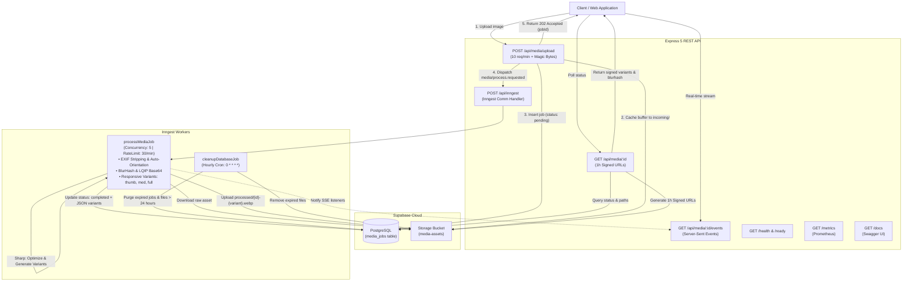

# Media Processing API

> Production-grade, asynchronous asset optimization pipeline built with **Express 5**, **TypeScript**, **Supabase Storage & PostgreSQL**, **Sharp**, and **Inngest**.

---

## 📖 Overview

The **Media Processing API** is an event-driven asset processing backend designed to handle CPU-heavy transformations off the main Node.js V8 thread:

1. **The Fast Door (O(1) Request Ingestion)**: Ingests image payloads via `multipart/form-data`, validates magic bytes, caches them in temporary storage, registers a `pending` job in PostgreSQL, dispatches an event to Inngest, and immediately returns `202 Accepted` with a tracking `jobId`.
2. **Durable Worker Pipelines**: Inngest step functions process the raw asset off-thread: stripping EXIF metadata, auto-orienting, generating responsive variants (`thumbnail`, `medium`, `full`), BlurHash strings, and LQIP data URLs.
3. **Strict Security with Dynamic Signed URLs**: Assets in private Supabase buckets are accessible only via dynamically generated 1-hour signed URLs with HMAC tokens.
4. **Real-Time Delivery (SSE)**: Clients can subscribe to `GET /api/media/:id/events` for instant status transitions without polling.
5. **Observability & Probes**: Exposes `/health`, `/ready` (deep dependency checks), and standard Prometheus `/metrics`.
6. **Automated Scheduled Garbage Collection**: An hourly Inngest cron job prunes media files and job records older than 24 hours.

---

## 🏛️ System Architecture



---

## 🚀 Key Features

* **Magic Byte MIME Validation**: Inspects actual binary header signatures (`file-type`) to reject disguised malicious files.
* **Tiered Rate Limiting**:
  * Uploads restricted to **10 requests per minute per IP** (`express-rate-limit`).
  * General endpoints throttled to **100 requests per minute per IP**.
* **Inngest Concurrency & Rate Controls**:
  * Worker concurrency limited to **5 parallel tasks** to prevent memory spikes.
  * Rate limited to **30 background executions per minute**.
* **Core Media Capabilities**:
  * **Responsive Variants**: Generates `thumbnail` (200x200), `medium` (800x800), and `full` (1920x1080) WebP assets.
  * **EXIF Metadata Stripping & Auto-Orientation**: Strips sensitive GPS/camera data while preserving orientation.
  * **BlurHash & LQIP**: Generates a compact BlurHash string and a Base64 Low-Quality Image Placeholder data URL for instant frontend rendering.
* **Real-Time Server-Sent Events (SSE)**: Stream status updates at `GET /api/media/:id/events`.
* **Health & Readiness Probes**: `/health` (liveness) and `/ready` (deep check on PostgreSQL and Supabase Storage).
* **Prometheus Metrics**: Standard `/metrics` endpoint measuring HTTP requests, durations, processing times, and upload counters.

---

## 🛠️ Tech Stack & Dependencies

* **Runtime**: [Node.js](https://nodejs.org/) (>= 20.0.0)
* **Framework**: [Express 5](https://expressjs.com/)
* **Database & Storage**: [Supabase](https://supabase.com/) (`@supabase/supabase-js`, PostgreSQL, Object Storage)
* **Background Orchestration**: [Inngest](https://www.inngest.com/) (`inngest`)
* **Image Processing**: [Sharp](https://sharp.pixelplumbing.com/) & [BlurHash](https://github.com/woltapp/blurhash)
* **Binary MIME Validation**: [file-type](https://github.com/sindresorhus/file-type)
* **Rate Limiting**: [express-rate-limit](https://github.com/express-rate-limit/express-rate-limit)
* **Metrics**: [prom-client](https://github.com/siimon/prom-client)
* **Documentation**: [Swagger UI Express](https://github.com/scottie1984/swagger-ui-express)

---

## 📁 Project Structure

```
media-processing-api/
├── openapi.json                  # OpenAPI 3.0 API specification
├── package.json
├── tsconfig.json
├── .env.example
├── README.md
├── src/
│   ├── app.ts                   # Express app factory, health, metrics, and middleware setup
│   ├── server.ts                # Server bootstrap & graceful shutdown listeners
│   ├── config/
│   │   ├── constants.ts         # Central configuration, variants, and Inngest limits
│   │   └── schema.sql           # Database schema & indexes for Supabase
│   ├── controllers/
│   │   └── media.controller.ts  # Upload, status with signed variants, and SSE streaming
│   ├── inngest/
│   │   ├── client.ts            # Inngest SDK client
│   │   ├── index.ts             # Function registry export
│   │   └── functions/
│   │       ├── processMedia.ts  # Worker with concurrency, EXIF, BlurHash, and variants
│   │       └── cleanupDatabase.ts # Scheduled hourly garbage collection
│   ├── middlewares/
│   │   ├── error.handler.ts     # Centralized error handler
│   │   ├── rate-limit.middleware.ts # Rate limiting (10 uploads/min)
│   │   └── upload.middleware.ts # Multer & binary magic byte validation
│   ├── repositories/
│   │   └── media.repository.ts  # Supabase PostgreSQL CRUD abstraction
│   ├── routes/
│   │   └── media.routes.ts      # REST API route declarations
│   ├── services/
│   │   ├── media.service.ts     # Business logic & compensating rollback actions
│   │   └── storage.service.ts   # Supabase Storage operations
│   ├── utils/
│   │   ├── app.error.ts         # Operational error class
│   │   ├── events.ts            # SSE event emitter manager
│   │   ├── metrics.ts           # Prometheus metrics definitions
│   │   ├── supabase.ts          # Supabase client singleton
│   │   └── swagger.ui.ts        # Swagger UI route binder
│   └── validators/
│       └── env.validator.ts     # Startup environment variable validation
```

---

## ⚙️ Prerequisites & Setup

### 1. Database & Storage Setup (Supabase)
Run the script in [`src/config/schema.sql`](src/config/schema.sql) in your Supabase SQL Editor and ensure a private storage bucket named **`media-assets`** exists.

### 2. Configure Environment Variables
Copy `.env.example` to `.env`:

```bash
cp .env.example .env
```

Set the required credentials:
```env
NODE_ENV=development
PORT=3000

SUPABASE_URL=https://<your-project-ref>.supabase.co
SUPABASE_SERVICE_KEY=<your-supabase-service-role-secret-key>

INNGEST_EVENT_KEY=<your-inngest-event-key>
INNGEST_SIGNING_KEY=<your-inngest-signing-key>
```

---

## 🏃 Running the Application

### Development Server
```bash
npm run start:dev
```
Server runs at `http://localhost:3000`.

### Inngest Local Dev Server
```bash
npx inngest-cli@latest dev -u http://localhost:3000/api/inngest
```
Access dashboard at `http://localhost:8288`.

### Production Build & Run
```bash
npm run build
npm start
```

---

## 📡 API Reference

| Method | Endpoint | Description |
| :--- | :--- | :--- |
| `POST` | `/api/media/upload` | Ingests image (10 req/min, magic bytes verified, returns 202) |
| `GET` | `/api/media/:id` | Polls status & dynamically returns 1-hour signed URLs for variants |
| `GET` | `/api/media/:id/events` | Real-time Server-Sent Events (SSE) status stream |
| `GET` | `/health` | Liveness probe (uptime, status) |
| `GET` | `/ready` | Deep readiness probe checking Database & Storage bucket health |
| `GET` | `/metrics` | Prometheus metrics export |
| `GET` | `/docs` | Interactive Swagger UI documentation |
| `POST` | `/api/inngest` | Inngest webhook communication endpoint |

---

## 📄 License

This project is licensed under the [ISC License](LICENSE).
